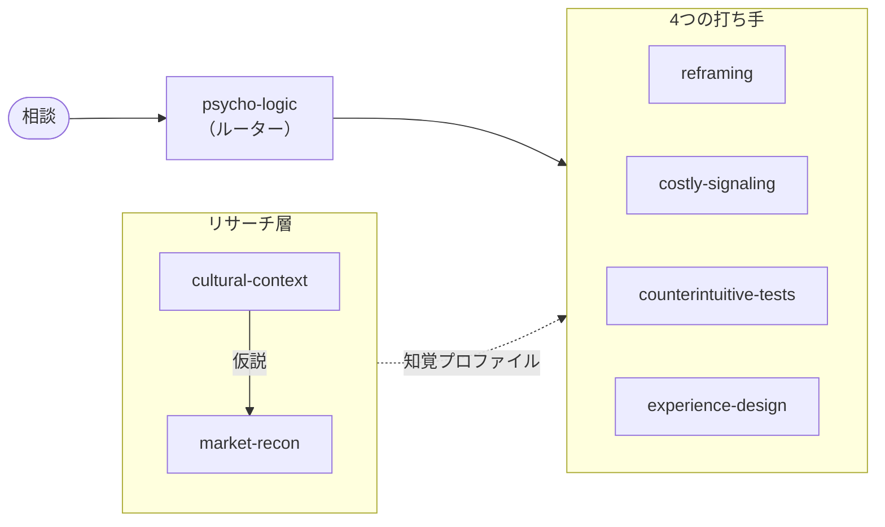

<div align="center">


# Alchemy Marketing Skills

**Rory Sutherland の「サイコロジック」を Claude スキル化**<br>
エンジニアリングや経済の指標ではなく、人間の「知覚」を解く。

[](./CHANGELOG.md)
[](./LICENSE)
[](https://code.claude.com/docs)

[English](./README.md) · **日本語**

</div>

---

論理的な打ち手はたいてい高くて遅く、競合も全員すでにやっています。心理的な打ち手はたいてい安くて速く、まだ誰も使っていません。これらのスキルは、Rory Sutherland が著書 [_Alchemy_](https://www.goodreads.com/book/show/55165511-alchemy) で示した流儀で Claude にマーケティング/プロダクトの問題を解かせます — **意味を変える・コストのかかるシグナルを送る・当たり前の逆を試す・体感する瞬間を作り直す**。

## スキル一覧



| 層 | スキル | 役割 |
|---|---|---|
| ルーター | [**psycho-logic**](./skills/psycho-logic/SKILL.md) | 問題を人間の言葉で言い換え、「指標を直す」というエンジニアの反射を抑え、下の4つの打ち手へ振り分ける。**まずここから。** |
| リサーチ | [**cultural-context**](./skills/cultural-context/SKILL.md) | 知覚を文化で読むレンズ。シグナルを送る前に、その地域・サブカルチャーがそれをどう読むか（不確実性回避、ハイ/ローコンテクスト、信頼の所在、タブー）を確立する。 |
| リサーチ | [**market-recon**](./skills/market-recon/SKILL.md) | 現地のライブ調査。現地語でのWebリサーチ（競合のシグナル・価格帯・信頼の源・タブー）を行い、4つの打ち手が使う「知覚プロファイル」に統合する。 |
| 打ち手 | [**reframing**](./skills/reframing/SKILL.md) | 中身（_what it is_）より先に「意味」（_what it means_）を変える、最も安いレバー。改名・再カテゴリ化・価格やメンタルアカウンティングの言い換え・価値の演出。 |
| 打ち手 | [**costly-signaling**](./skills/costly-signaling/SKILL.md) | なぜ高価・無駄・手間・自虐が信頼と欲求を生むのか。保証、ブランド広告費、価格＝品質シグナル、プラットフォール効果（正直な弱点）。 |
| 打ち手 | [**counterintuitive-tests**](./skills/counterintuitive-tests/SKILL.md) | 「良いアイデアの逆もまた良いアイデアになりうる」。論理的に聞こえないアイデアを生成し、安く・元に戻せる行動実験で検証する — 人は言う通りには動かないから。 |
| 打ち手 | [**experience-design**](./skills/experience-design/SKILL.md) | 論理的に重要な「指標」ではなく、心理的に重要な「瞬間」を直す。不確実性＞遅延、手持ち無沙汰＞占有時間、平均＜ピーク・エンド。 |

各スキルの本文は英語ですが、すべてのスキルに **日本語の使用例** セクションがあります（葬儀/シニア文脈の例を含む）。description には日本語・中国語のトリガー句が入っており、3言語どの相談でも発火します。また各スキルは提案を著名な理論（Kahneman、Cialdini、Byron Sharp、Maister ほか）と相互チェックし、根拠を求められれば Web 検索で出典を引きます。

## インストール

**プラグインとして（推奨）**

```
/plugin marketplace add meikocho1/alchemy-marketing-skills
/plugin install alchemy-marketing@alchemy-marketing-skills
```

**手動** — `skills/` 配下の任意のフォルダを `~/.claude/skills/`（またはプロジェクトの `.claude/skills/`）にコピーするだけ。各スキルは単独で完結した `SKILL.md` です。

## 仕組み

リクエストがスキルの `description` に一致すると、Claude が自動でそのスキルを読み込みます。普通のマーケティングの相談を投げれば、該当スキルが発火します。

- _「商品は良いのに全然売れない」_
- _「値下げせずに高級感を出したい」_
- _「なぜ信頼されないのか」_
- _「待ち時間のクレームがひどい」_

**psycho-logic** が入口になり、他へ振り分けます。

## リポジトリ構成

```
.claude-plugin/    plugin.json と marketplace.json（プラグイン／マーケットプレイスのマニフェスト）
skills/<name>/     SKILL.md と evals/evals.json（1 スキル 20 件の評価ケース）
optimize/          SkillOpt ハーネス: train.py と config.yaml
assets/            icon.svg
```

## スキルの測定と最適化

`optimize/` は [SkillOpt](https://github.com/microsoft/SkillOpt) を使い、各スキルを `evals/evals.json` で採点・学習します。ローカルの Claude Code のログイン（`claude -p`）で動きます。SkillOpt をこのリポジトリの隣に clone して `../SkillOpt/.venv` に編集可能モードでインストール（`pip install -e .`。基本設定は clone 側にあるため）してから:

```
../SkillOpt/.venv/bin/python optimize/train.py reframing --eval   # 今の SKILL.md を 20 件で採点
../SkillOpt/.venv/bin/python optimize/train.py reframing          # 学習。best_skill.md は optimize/runs/reframing/<日時>/ に出る
```

1 回の実行でモデルを数百回呼び出します。1 スキル 20 件だと同じ条件でも点数が ±0.03（soft）ほどぶれるので、`best_skill.md` はそのまま差し替えず、レビューする提案として扱ってください。`market-recon` は Web 検索が前提ですが採点環境では使えないため、点数は参考になりません。

## クレジットと免責

アイデア・フレームワーク・事例は **Rory Sutherland**（Ogilvy UK 副会長）の仕事 — とりわけ著書 _Alchemy: The Dark Art and Curious Science of Creating Magic in Brands, Business, and Life_、TED トーク、コラム — に基づいています。本プロジェクトは **非公式・教育目的** であり、Rory Sutherland 氏および Ogilvy とは **一切関係なく、公認されたものでもありません**。原著をぜひ読んでください — どんなスキルファイルよりも面白いです。

サイコロジックは、実体を本当に良くし、本物の価値を引き出すためのものです。シグナルは正直に、希少性は本物で、リフレーミングは真実であるべき。顧客に知られたら崩れるトリックは、戦術ではなく負債です。

## 更新履歴

[CHANGELOG.md](./CHANGELOG.md) を参照してください。

## ライセンス

[MIT](./LICENSE) © 2026 meiko.cho
