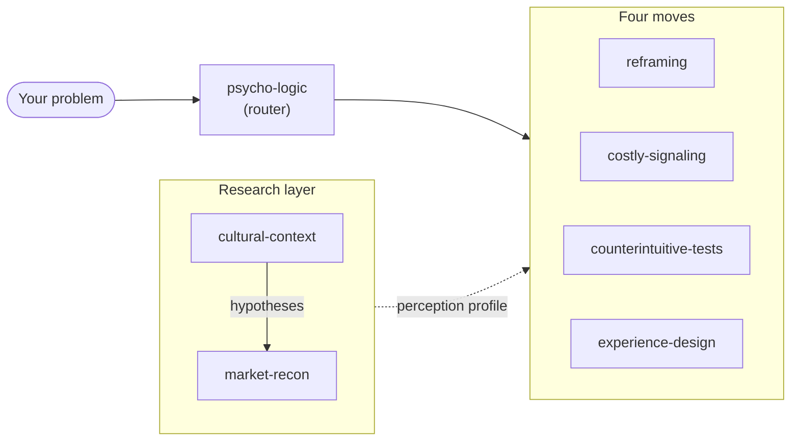

<div align="center">


# Alchemy Marketing Skills

**Rory Sutherland's _psycho-logic_ as Claude skills**<br>
Solve the human perception, not just the engineering or economic metric.

[](./CHANGELOG.md)
[](./LICENSE)
[](https://code.claude.com/docs)

**English** · [日本語](./README.ja.md)

</div>

---

The logical fix is usually expensive, slow, and already done by every competitor. The psychological fix is usually cheap, fast, and unexploited. These skills make Claude attack marketing and product problems the way Rory Sutherland does in [_Alchemy_](https://www.goodreads.com/book/show/55165511-alchemy): reframe the meaning, send a costly signal, invert the obvious and test it, or redesign the felt moment.

## The skills



| Layer | Skill | What it does |
|---|---|---|
| Router | [**psycho-logic**](./skills/psycho-logic/SKILL.md) | Diagnoses a problem in human terms, resists the engineer's reflex to fix the metric, and dispatches to one of the four moves below. **Start here.** |
| Research | [**cultural-context**](./skills/cultural-context/SKILL.md) | The perception-by-culture lens. Establishes how a specific region or subculture reads a signal — uncertainty avoidance, high/low context, trust locus, taboos — before you send it. |
| Research | [**market-recon**](./skills/market-recon/SKILL.md) | Live fieldwork. Structured web research in the local language — competitors' signals, price bands, trust sources, taboos — synthesised into a perception profile the four moves consume. |
| Move | [**reframing**](./skills/reframing/SKILL.md) | Change what something _means_ before changing what it _is_ — the cheapest lever. Renaming, recategorising, price / mental-accounting reframes, manufactured value. |
| Move | [**costly-signaling**](./skills/costly-signaling/SKILL.md) | Why expensive, wasteful, effortful, or self-deprecating actions build trust and desire. Guarantees, brand spend, price-as-quality, and the Pratfall Effect (the honest flaw). |
| Move | [**counterintuitive-tests**](./skills/counterintuitive-tests/SKILL.md) | "The opposite of a good idea can be a good idea." Generate ideas that don't sound logical, then validate them with cheap, reversible behavioural experiments — because people don't do what they say. |
| Move | [**experience-design**](./skills/experience-design/SKILL.md) | Fix the psychologically significant moment, not the logically significant metric. Uncertainty beats delay, occupied time beats idle time, peak-end beats average. |

Each skill's body is in English and includes a **日本語の使用例** (Japanese usage examples) section. Skill descriptions carry Japanese and Chinese trigger phrases, so prompts in all three languages fire the right skill. Each skill also cross-checks its advice against the wider canon (Kahneman, Cialdini, Byron Sharp, Maister, …) and web-searches the named theory or case when you ask for evidence.

## Install

**As a plugin (recommended)**

```
/plugin marketplace add meikocho1/alchemy-marketing-skills
/plugin install alchemy-marketing@alchemy-marketing-skills
```

**Manually** — copy any folder under `skills/` into your `~/.claude/skills/` (or a project's `.claude/skills/`). Each skill is a self-contained `SKILL.md`.

## How it works

Claude loads a skill automatically when your request matches its `description`. Ask a normal marketing question and the relevant skill fires:

- _"The product's fine but nobody converts."_
- _"How do we make this feel premium without dropping the price?"_
- _"Why don't people trust us?"_
- _"The wait-time complaints are killing us."_

**psycho-logic** is the entry point and routes to the others.

## Repository layout

```
.claude-plugin/    plugin.json and marketplace.json (plugin + marketplace manifests)
skills/<name>/     SKILL.md, plus evals/evals.json (20 eval cases per skill)
optimize/          SkillOpt harness: train.py and config.yaml
assets/            icon.svg
```

## Measuring and optimizing the skills

`optimize/` scores or trains one skill against its `evals/evals.json` with [SkillOpt](https://github.com/microsoft/SkillOpt), using your local Claude Code login (`claude -p`). Clone SkillOpt next to this repo and install it editable into `../SkillOpt/.venv` (`pip install -e .` — the base config lives in the checkout), then:

```
../SkillOpt/.venv/bin/python optimize/train.py reframing --eval   # score the current SKILL.md on all 20 evals
../SkillOpt/.venv/bin/python optimize/train.py reframing          # train; best_skill.md lands in optimize/runs/reframing/<timestamp>/
```

Each run makes a few hundred model calls. With 20 evals per skill, scores move by about ±0.03 (soft) between identical runs, so treat `best_skill.md` as a proposal to review, not a drop-in replacement. `market-recon` needs web search, which the scoring harness does not allow, so its scores are not meaningful.

## Credit & disclaimer

The ideas, frameworks, and examples are drawn from the work of **Rory Sutherland** (Vice Chairman, Ogilvy UK) — chiefly his book _Alchemy: The Dark Art and Curious Science of Creating Magic in Brands, Business, and Life_, his TED talks, and his columns. This is an **unofficial, educational** project and is **not affiliated with or endorsed by** Rory Sutherland or Ogilvy. Read the book — it's better than any skill file.

Psycho-logic is for making real things better and surfacing real value. Signals should be honest, scarcity real, and reframes truthful. A trick that doesn't survive the customer finding out is a liability, not a tactic.

## Changelog

See [CHANGELOG.md](./CHANGELOG.md).

## License

[MIT](./LICENSE) © 2026 meiko.cho
